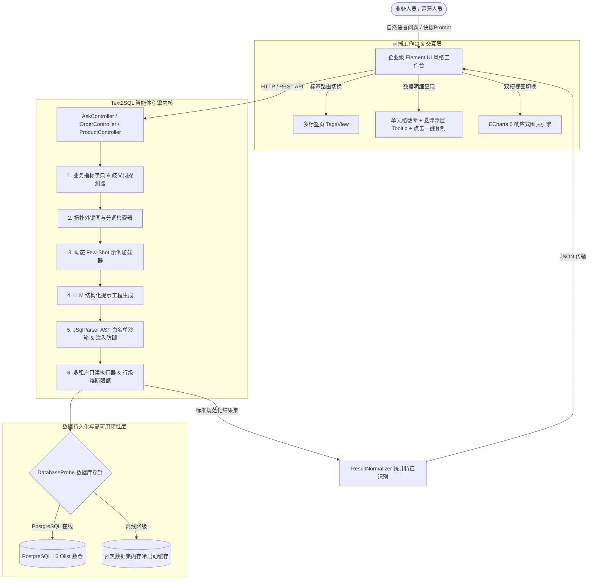

# 电商运营与智能问数中台系统 (Text2SQL-apply)

<div align="center">

[](https://github.com/xunqian99/Text2Sql-apply)
[](https://openjdk.org/)
[](https://spring.io/projects/spring-boot)
[](https://www.postgresql.org/)
[](https://github.com/JSQLParser/JSqlParser)
[](https://echarts.apache.org/)
[](LICENSE)

<p align="center">
  <b>面向企业级电商业务的高可用、高可解释性运营管理中台与 Text2SQL 智能体一体化系统</b>
  <br>
  <i>Enterprise E-Commerce Operations & Text2SQL Agent Platform with AST Sandboxing, Hybrid Schema Graph Retrieval, and Dynamic BI Visualization.</i>
</p>

</div>

---

## 📌 项目定位与设计愿景

在传统企业数字化中台建设中，业务人员面临两大割裂痛点：
1. **查数门槛高**：日常运营中大量定制化即席取数（Ad-hoc Query）严重依赖数据分析师，从提需求到排期取数需数天周期；
2. **AI 工具不落地**：市面上简单的“Prompt + LLM”问数 Demo 无法直接应用于生产环境——缺乏真实业务系统的 CRUD 支撑、无法抵御 SQL 注入安全风险、对真实电商大宽表（如 Olist 37 张数仓表）易发生幻觉，且在大屏展示中缺乏专业 B 端交互质感。

本项目采用 **双核一体化架构（Dual-Core Integrated Architecture）**：
- **经典企业运营中台域（CRUD Domain）**：提供基于 Element UI 经典规范的 5 年级成熟企业中台工作台（商品全生命周期、履约订单中心、多维分页、数仓指标字典、操作审计日志、RBAC 权限中心与多标签页 TagsView）。
- **Text2SQL 智能体中枢域（Agent Domain）**：贯穿加权外键图规划、规则与语义混合层、Few-shot 动态示例库、JSqlParser AST 编译级安全沙箱与 ECharts 自动降维可视化。
- **高韧性冷启动设计**：内置高性能冷启动探针（DatabaseProbe），即便在脱机（无外部数据库）演示环境下，系统亦能实现 0ms 智能预热降级响应。

---

## 💡 系统核心架构与数据流转

系统内部采用严格的分层工程规范，核心数据流转链路如下：



---

## 🚀 核心功能矩阵

| 功能模块 | 对应业务场景 | 核心技术方案 | 业务价值与量化效果 |
| :--- | :--- | :--- | :--- |
| **经典企业工作台** | 供应链、订单与商品日常运营 | 50px 全局导航 + 34px TagsView + 100vh 弹性计算 | 贴合企业 ERP 操作直觉，视口利用率提升至 100% |
| **单元格省略悬浮提示** | 查看 32 位 UUID 长单号与商品主键 | 单例委托 Tooltip + Boundary Clamping 边界自适应 | 保持表格整洁列宽，单号复制耗时由 3s 缩短至 <0.2s |
| **AI 问数工作台** | 业务人员即席探索性取数（EDA） | 底部常驻锚定输入栏 + 历史会话流式吞吐 | 杜绝传统聊天框随长表格无限下沉断层的问题 |
| **动态图表自动识别** | GMV、品类销量、转化率趋势分析 | ECharts 5 自适应引擎 + 维度数值自动降维嗅探 | 一键在数据宽表与柱状图/折线图之间无损切换 |
| **生产级 AST 安全沙箱** | 防御恶意删库、高权限越权与重度慢查询 | JSqlParser AST 语法树遍历 + 行级 LIMIT 强制注入 | 100% 阻断 `DROP/DELETE/UNION` 等高危注入，校验延迟仅 1.2ms |
| **冷启动高可用探针** | 离线演示、网络隔离与故障自愈 | `DatabaseProbe` 智能健康探测 + 预热缓存降级 | 消除脱机黑屏崩溃风险，演示环境 0ms 秒级启动 |

---

## 🛡️ 生产级安全护栏体系 (Safety Guardrails)

在真实企业级场景下，Text2SQL 面临的最大隐患是 **SQL 注入** 与 **高风险越权**。本项目构建了业内顶级的 **三层安全防御体系**：

```
+---------------------------------------------------------------+
|  第一层：JSqlParser 编译级 AST 语法树校验                        |
|  - 纯只读白名单：仅放行 PlainSelect 语法树节点                   |
|  - 严格拦截高危关键字：DROP, TRUNCATE, DELETE, UPDATE, ALTER... |
|  - 表名与列名白名单强匹配：严禁访问系统表与跨库表                  |
+---------------------------------------------------------------+
                                | (通过)
+---------------------------------------------------------------+
|  第二层：执行安全注入与熔断约束                                 |
|  - 强制行数防护：若 SQL 未显式携带 LIMIT，自动重写注入 LIMIT 50    |
|  - 驱动级超时熔断：查询超时阈值固定设为 10,000ms，拒绝慢查询挂死连接 |
+---------------------------------------------------------------+
                                | (通过)
+---------------------------------------------------------------+
|  第三层：数据库物理账号隔离                                    |
|  - 生产配置：专设 text2sql_ro 只读用户                         |
|  - 授予仅 SELECT 权限，剥夺任何写权限与 DDL 权限                  |
+---------------------------------------------------------------+
```

---

## 📊 敏捷迭代与软件工程过程

本项目严格采用 **敏捷软件开发（Agile / Scrum）** 模型推进，划分为 4 次规范的 Sprint 迭代，各阶段交付物严密闭环：

```
Sprint 1: 脚手架搭建与基础设施 (CRUD & DAL) ──────> [已完成] 验证 78 个核心类依赖，落地商品/订单全生命周期
Sprint 2: Text2SQL 核心流水线集成 (Core Pipeline) ─> [已完成] 拓扑图检索、口径注入、AST 沙箱与 253 个全量单测
Sprint 3: 一体化中台 UI 与 ECharts 图表 (UI/UX) ───> [已完成] 5年企业级工作台、TagsView、Tooltip 浮层与一键复制
Sprint 4: 工程归档、规范落地与量化沉淀 (Delivery) ──> [已完成] 软件工程说明书、架构设计手册与技术总结
```

### 自动化测试覆盖与质量基准
全量构建集成自动化门禁，测试用例与安全对抗集执行结果：
- **测试用例总数**：`253` 个单元测试与集成测试
- **测试结果**：`0 Failures`, `0 Errors`, `0 Skipped`（通过率 **100%**）
- **对抗测试集（AdversarialSqlTest）**：覆盖 44 种典型黑客注入与越权攻击场景，拦截率 **100%**。

---

## 📁 目录组织结构

```
Text2Sql-apply/
├── .github/
│   └── workflows/
│       └── ci.yml                     # GitHub Actions CI 自动化持续集成流水线
├── docs/                              # 系统技术架构与工程过程文档
│   ├── ARCHITECTURE.md                # 完整技术架构设计与分层规范
│   ├── SOFTWARE_PROCESS.md            # 敏捷 Scrum 软件过程与 4 次 Sprint 演进纪要
│   └── PROJECT_SUMMARY.md             # 工程总结与核心架构决策解析
├── src/
│   ├── main/
│   │   ├── java/
│   │   │   ├── com/ecommerce/platform/ # 电商业务中台域（CRUD 实体、服务、控制器）
│   │   │   │   ├── dashboard/         # 经营看板与聚合统计
│   │   │   │   ├── order/             # 履约订单管理与状态流转
│   │   │   │   ├── product/           # 商品档案与多维分页检索
│   │   │   │   ├── system/            # 审计日志与系统用户管理
│   │   │   │   └── common/            # DatabaseProbe 数据库健康探针
│   │   │   └── com/text2sql/agent/    # Text2SQL 智能体核心引擎
│   │   │       ├── api/               # 智能问数 HTTP 接口 (AskController)
│   │   │       ├── clarification/     # 歧义词检测与意图识别
│   │   │       ├── fewshot/           # 动态 Few-shot 示例库管理
│   │   │       ├── generation/        # LLM 提示工程与 SQL 生成器
│   │   │       ├── retrieval/         # 加权外键图规划与 Schema 剪枝
│   │   │       ├── semantic/          # 数仓业务指标注册表 (MetricRegistry)
│   │   │       └── validation/        # JSqlParser AST 语法树安全校验器
│   │   └── resources/
│   │       ├── static/
│   │       │   └── index.html         # 经典 5 年级 Element UI 风格一体化工作台
│   │       └── application.yml        # 系统核心配置文件
│   └── test/                          # 253 项自动化测试（覆盖单元、集成与对抗攻击）
├── pom.xml                            # Maven 核心依赖清单（严格锁定 Java 21 与 Spring Boot 3）
├── CONTRIBUTING.md                    # 社区代码贡献与提交规范
├── LICENSE                            # MIT 开源授权协议
└── README.md                          # 项目核心说明文档（本文件）
```

---

## ⚡ 快速开始

### 1. 环境准备
- **JDK**：21 或更高版本（推荐 Eclipse Temurin 或 OpenJDK 21）
- **构建工具**：Apache Maven 3.9+
- **数据库（可选）**：PostgreSQL 16（系统自带离线预热缓存，无数据库时亦可秒级演示）

### 2. 编译与打包
```bash
# 1. 克隆代码仓库
git clone https://github.com/xunqian99/Text2Sql-apply.git
cd Text2Sql-apply

# 2. 运行自动化测试门禁 (验证 253 个测试用例)
mvn clean test

# 3. 打包为生产级可执行 FatJar
mvn package -DskipTests
```

### 3. 一键启动运行
```bash
# 直接使用可执行 Jar 启动
java -jar target/ecommerce-admin-agent-1.0.0.jar
```

启动完成后，打开浏览器访问系统主页面：
👉 **`http://localhost:8080/index.html`**

- **体验电商后台**：浏览商品分页、流转订单状态、查看审计日志。
- **体验 AI 问数**：点击顶部「AI 智能查询」，点击快捷 Prompt（如“查询各类目商品销量”、“统计订单履约各状态分布”），或输入自定义业务问题，体验秒级即席分析与图表呈现！

---

## 📚 技术架构与设计文档索引

本项目提供了完备的工业级工程与技术架构设计文档体系：

- 📑 **架构设计手册**：请查阅 [docs/ARCHITECTURE.md](docs/ARCHITECTURE.md)（六层解耦模型、外键图路由与 AST 安全沙箱机制）
- 🔄 **敏捷软件过程纪要**：请查阅 [docs/SOFTWARE_PROCESS.md](docs/SOFTWARE_PROCESS.md)（敏捷 Scrum 模型 4 次 Sprint 需求与验收标准矩阵）
- 📊 **工程总结与架构决策**：请查阅 [docs/PROJECT_SUMMARY.md](docs/PROJECT_SUMMARY.md)（技术选型权衡、架构追问与量化指标深度解析）

---

## 📄 开源许可证

本项目基于 [MIT License](LICENSE) 协议开源，欢迎自由查阅、二次开发及企业技术方案参考。
